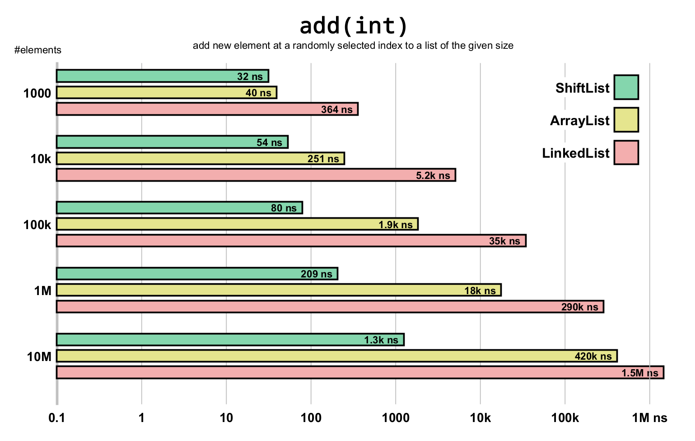
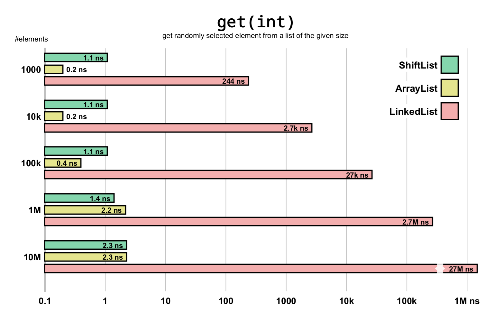

# Common

[](https://mvnrepository.com/artifact/org.int4.common)
[](https://github.com/int4-org/Common/actions)
[](https://codecov.io/gh/int4-org/Common)
[](https://opensource.org/licenses/MIT)
[](https://javadoc.io/doc/org.int4.common/parent)

Commonly usable classes without dependencies.

## `common-collection`

Contains specialized collection classes. See the highlights below for details:

- [`ShiftList`](#orgint4commoncollectionshiftlist): a `List` and `Deque` optimized for frequent
  insertions and removals near the head, tail, or any index.
- [`HashList`](#orgint4commoncollectionhashlist): a specialized `List` for listener-style
  collections where elements are appended, iterated in order, and removed by equality.
- [`cow.BTreeList`](#orgint4commoncollectioncow): a copy-on-write `List` with fast access and
  fast insertions and removals at any index, which can be cloned in constant time and frozen.

## `common-function`

Contains additional functional interfaces:

- Consumers with more arguments:
  - `TriConsumer`
  - `QuadConsumer`
- Functions with more arguments:
  - `TriFunction`
  - `QuadFunction`
- Throwing variants of common functional interfaces:
  - `ThrowingConsumer`
  - `ThrowingFunction`
  - `ThrowingRunnable`
  - `ThrowingSupplier`

## `common-test`

Contains a specialized testing framework for exhaustive state-space exploration. See the [common-test README](common-test/README.markdown) for a detailed user guide.

- `ExploratoryTestRunner`: Exhaustively explores an `Explorable` model by applying `@Action` and
  verifying `@Assertion` annotations. Features include:
  - **State Pruning**: Aggressively deduplicates explored states for performance.
  - **History-Based Pruning**: Optional `historyDepth` parameter to detect bugs hidden by logical
    state equality (the "Hidden State" problem).
  - **Path Bounding**: Supports `maxDepth` to ensure termination in unbounded state spaces.

# Highlights

## Exploratory Testing

The `ExploratoryTestRunner` provides a simple but powerful way to perform **Exhaustive State-Space Exploration**
on any Java model. By defining actions and assertions on an `Explorable` implementation, the runner
systematically explores all reachable states up to a certain depth.

Key features:
- **Deterministic and Exhaustive**: Unlike random testing (PBT), it tests every possible sequence of
  actions, ensuring no edge case is missed within the search depth.
- **Automatic State Pruning**: Uses `snapshot()` to identify states it has already visited, avoiding
  redundant exploration and allowing it to test millions of paths with minimal effort.
- **Shortest Path Guarantee**: Because it uses Breadth-First Search (BFS), the first time a bug is
  found, the reported action sequence is guaranteed to be the shortest possible reproduction path.
- **JUnit 5 Integration**: Leverages standard JUnit annotations like `@ValueSource`, `@EnumSource`,
  and `@MethodSource` to parameterize actions.

```java
public class MyModel implements Explorable {
  private final List<String> expected = new ArrayList<>();
  private final List<String> list = new MyList<>();

  @Action
  @ValueSource(strings = {"A", "B"})
  public Runnable add(String s) {
    expected.add(s);           // Update expectation
    return () -> list.add(s);  // Perform effect
  }

  @Assertion
  public void check() {
    assertThat(list).isEqualTo(expected);
  }

  @Override
  public Object snapshot() {
    return new ArrayList<>(expected);
  }
}

// Explore all paths up to depth 6
ExploratoryTestRunner.explore(MyModel.class, MyModel::new, 6);
```

## `org.int4.common.collection.ShiftList`

`ShiftList` is a high-performance, general-purpose `List` and `Deque` implementation optimized for
use cases where frequent insertions and removals occur near the head or tail of the list. It combines
the performance benefits of block-based storage with a rotating offset mechanism to avoid costly
element shifts typical of `ArrayList`.

### Why `ShiftList`?

Standard Java collections like `ArrayList` and `LinkedList` trade off insertion/removal speed,
memory locality, and access time:

- `ArrayList` provides fast indexed access but performs progressively worse when inserting or removing elements
  further from the end, due to the need to shift elements.

- `LinkedList` allows efficient insertions/removals at both ends but has poor cache performance and slow random access.

- `ShiftList` is designed to support fast insertions and removals at any index (especially at the head and tail)
  while maintaining random access performance comparable to `ArrayList`.

### Key Design Concepts

- **Block-based storage**: The list is internally divided into fixed-size blocks within a contiguous array.
  Block size is dynamically determined based on capacity, and tuned for optimal performance.

- **Block rotation**: Instead of shifting elements on every insert/remove, blocks are rotated, with only overflow
  elements moved between them. This make structural modifications proportional to the number of affected blocks,
  not the total element count.

- **Global rotation**: A global rotation offset enables fast modifications near the list's start, effectively
  halving the number of affected blocks. Operations near the head or tail are close to `O(1)`, while those nearer
  to the middle degrade gradually to `O(n/b)` where `b` is the block size used.

### Benchmark Summary

All benchmarks were performed using [JMH](https://github.com/openjdk/jmh). For raw data see the [benchmarks](https://github.com/int4-org/Common/tree/master/common-collection/benchmarks) folder.
The lists compared are JDK's `ArrayList`, `LinkedList`, and Apache Commons Collections' `TreeList`.




#### Insertions and removals

Measurements were done performing exactly 10,000 operations per iteration. For smaller lists, several
lists were used to not exceed `0.5 * size` elements added per list. The resuls are in nano seconds per
element. Bolded results are fastest or within 10% of fastest.

| Operation    |     Size   |  ShiftList  |  ArrayList  | LinkedList  |   TreeList  |
|--------------|-----------:|------------:|------------:|------------:|------------:|
|Add First     |      1,000 |  **2.4 ns** |     54.8 ns |  **2.3 ns** |     57.2 ns |
|Add First     |    100,000 |      2.4 ns |  3,656.5 ns |  **1.8 ns** |    107.9 ns |
|Add First     | 10,000,000 |  **3.5 ns** |       (*) - |  **3.8 ns** |    134.1 ns |
|Add Last      |      1,000 |  **2.2 ns** |      2.6 ns |  **2.3 ns** |     54.5 ns |
|Add Last      |    100,000 |      2.3 ns | (**) 5.0 ns |  **1.8 ns** |     97.0 ns |
|Add Last      | 10,000,000 |  **3.7 ns** |  **3.9 ns** |  **3.9 ns** |    140.0 ns |
|Add Random    |      1,000 | **32.4 ns** |     40.5 ns |    364.5 ns |     60.7 ns |
|Add Random    |    100,000 | **80.6 ns** |  1,905.4 ns | 34,570.5 ns |    284.7 ns |
|Add Random    | 10,000,000 |**1,263.7 ns**|419,777.2 ns|       (*) - |  1,517.1 ns |
|Remove First  |      1,000 |  **1.8 ns** |     38.7 ns |  **1.7 ns** |     34.8 ns |
|Remove First  |    100,000 |  **1.7 ns** |  3,191.3 ns |  **1.8 ns** |     99.0 ns |
|Remove First  | 10,000,000 |  **2.3 ns** |       (*) - |      2.6 ns |    113.7 ns |
|Remove Last   |      1,000 |      1.6 ns |  **0.3 ns** |      1.7 ns |     36.9 ns |
|Remove Last   |    100,000 |      1.6 ns |  **0.6 ns** |      1.7 ns |     84.7 ns |
|Remove Last   | 10,000,000 |      2.2 ns |  **1.1 ns** |      2.0 ns |    140.0 ns |
|Remove Random |      1,000 | **24.8 ns** |     29.0 ns |    164.0 ns |     50.2 ns |
|Remove Random |    100,000 | **94.4 ns** |  1,596.7 ns | 25,125.0 ns |    323.2 ns |
|Remove Random | 10,000,000 |  1,923.8 ns |399,569.4 ns |       (*) - |**1,423.9 ns**|

> (*) Timed out (max 1 minute per test)\
> (**) `ArrayList` does a re-allocate at 106,710 elements which skewed these results a bit

#### Reading

| Operation    |     Size   | ShiftList |  ArrayList  | LinkedList  |   TreeList  |
|--------------|-----------:|----------:|------------:|------------:|------------:|
|Get Random    |      1,000 |    1.1 ns |  **0.2 ns** |    243.6 ns |     34.6 ns |
|Get Random    |    100,000 |    1.1 ns |  **0.4 ns** | 26,924.8 ns |    121.9 ns |
|Get Random    | 10,000,000 |**2.3 ns** |  **2.2 ns** |       (*) - |    658.8 ns |
|Get Sequential|      1,000 |    0.7 ns |  **0.1 ns** |    228.0 ns |      9.2 ns |
|Get Sequential|    100,000 |    0.7 ns |  **0.1 ns** | 27,226.6 ns |     37.6 ns |
|Get Sequential| 10,000,000 |    0.7 ns |  **0.1 ns** |       (*) - |     43.6 ns |

> (*) Timed out (max 1 minute per test)

### Time complexity

| Operation              | ShiftList | ArrayList | LinkedList | TreeList  |
|------------------------|:---------:|:---------:|:----------:|:---------:|
| Add/remove at tail     | `O(1)`    | `O(1)`    | `O(1)`    | `O(log n)` |
| Add/remove at head     | `O(1)`    | `O(n)`    | `O(1)`    | `O(log n)` |
| Random access          | `O(1)`    | `O(1)`    | `O(n)`    | `O(log n)` |
| Add/remove at index    | `O(n/b)`  | `O(n)`    | `O(n)`    | `O(log n)` |

> Where `n` is the number of elements the list holds, and `b` is the block size of `ShiftList`

`ShiftList` provides performance close to `ArrayList` for the common `get(int)` operation due to minimal
indirection when locating an element. In contrast, `LinkedList` and `TreeList` require pointer traversal,
which incurs higher actual latency than their asymptotic complexity suggests.

| Feature                  | ShiftList | ArrayList | LinkedList | TreeList  |
|--------------------------|:---------:|:---------:|:----------:|:---------:|
| Memory locality          | ++        | ++        | --         | --        |
| Estimated memory/element | 4-8 bytes | 4-6 bytes | ~24 bytes  | ~32 bytes |

`LinkedList` and `TreeList` allocate a wrapper object per element, leading to high memory overhead
and poor memory locality due to non-contiguous storage. `ShiftList` stores elements in contiguous
blocks, improving cache performance. Its capacity is always a power of two, and in the worst case
(50% utilization), memory usage is approximately 8 bytes per element. By contrast, `ArrayList`
typically grows by 50% when resizing and can trim to fit, leading to more compact memory usage when
fully utilized.

### Limitations

- `ShiftList` has a minimum capacity of 16 elements
- `ShiftList` has a maximum capacity of 2^30 - 65536 elements (this is due to the restriction that
  its storage array must be a power of 2 in size, and that its first and last element can't be in
  the same block.)

## `org.int4.common.collection.HashList`

`HashList` is a specialized `List` implementation intended for collections that are built by
appending and where elements are frequently removed by equality while being iterated in insertion
order. Listener lists, as commonly maintained by UI frameworks, are the primary use case: listeners
are appended as they are registered, removed when they are unregistered, and iterated in
registration order when events are dispatched.

`HashList` is not a drop-in replacement for `ArrayList`. Removing an element leaves a gap
(tombstone) in the backing array, so indexed access such as `get(int)` and `remove(int)` must scan
past those gaps and can degrade to `O(n)`. Use `HashList` when appends, iteration, `contains` and
`remove(Object)` dominate; use `ArrayList` when fast random access by index is important.

### Why `HashList`?

Listener-style collections are a poor fit for the standard collection types:

- `ArrayList` preserves order and allows duplicates, but `remove(Object)` first walks the list and
  then consolidates the elements that follow. For a long-lived listener list, repeated removals can
  cause large and repeated array moves.

- `HashSet` and `LinkedHashSet` provide fast membership testing and removal, but do not allow
  duplicates and are not `List` implementations, so they cannot model duplicate listener
  registrations while preserving registration order.

- `HashList` keeps insertion order, allows duplicates (the same listener can be registered more
  than once), and provides `O(1)` average `contains` and `remove(Object)` for larger lists. Instead
  of shifting the remaining elements, it leaves a tombstone, and consolidates only when tombstones
  accumulate.

### Key Design Concepts

- **Array-backed storage**: Elements are kept in a contiguous array in insertion order, which gives
  good memory locality and makes appending an `O(1)` amortized operation.

- **Tombstones**: Removing an element leaves a `null` gap (tombstone) in the array instead of
  shifting the remaining elements. Indexed access must skip these gaps, which is why `get(int)` and
  `remove(int)` are not constant-time once the list contains tombstones.

- **Adaptive hash index**: Once a list grows beyond about 32 elements, `HashList` maintains hash
  chains over the elements using bucket head/tail indices and per-slot next links. This makes
  `contains` and `remove(Object)` `O(1)` on average, even with duplicates present. Smaller lists
  skip the index entirely to avoid unnecessary overhead.

- **Consolidation and shrinking**: When tombstones exceed a quarter of the backing array, the list
  compacts the remaining elements in a single pass and rebuilds the hash index. When the list has
  shrunk far below its capacity, the backing arrays are halved. Consolidation is therefore batched
  rather than performed on every removal.

- **Insertion-order iteration**: Iterators walk the backing array while skipping tombstones, so
  iteration remains `O(n)` overall and always sees elements in insertion order.

### Time complexity

| Operation             | HashList                                                 | ArrayList     | LinkedList    |
|-----------------------|----------------------------------------------------------|:-------------:|:-------------:|
| Append                | `O(1)` amortized                                         | `O(1)`        | `O(1)`        |
| Get by index          | `O(n)` worst case                                        | `O(1)`        | `O(n)`        |
| Contains              | `O(1)` average for larger lists, `O(n)` for small lists  | `O(n)`        | `O(n)`        |
| Remove by equality    | `O(1)` average for larger lists, `O(n)` for small lists  | `O(n)`        | `O(n)`        |
| Remove by index       | `O(n)` worst case                                        | `O(n)`        | `O(n)`        |
| Iteration             | `O(n)`                                                   | `O(n)`        | `O(n)`        |
| Insert/set by index   | unsupported                                              | `O(n)`/`O(1)` | `O(n)`/`O(n)` |

`HashList` therefore trades random access for cheap removals. For workloads that repeatedly access
elements by index, `ArrayList` remains the better choice.

### Memory usage

For lists under about 32 elements, `HashList` stores only the element array and has memory usage
comparable to `ArrayList`. Larger lists additionally allocate hash indexing arrays, increasing
memory usage by roughly a factor of 2 to 3 compared to the element array alone. Capacity is always
a power of two, and the list compacts or shrinks its arrays as elements are removed.

### Limitations

- `HashList` does not permit `null` elements.
- Elements can only be appended; inserting at an arbitrary index and replacing elements via `set`
  are unsupported.
- Indexed access and index-based removal degrade to `O(n)` while the backing array contains
  tombstones. `HashList` is not a general-purpose replacement for `ArrayList`; prefer iteration
  over index-based loops and use `ArrayList` when fast random access is needed.
- Ties between equal elements are resolved in insertion order: `remove(Object)` removes the first
  matching occurrence.

## `org.int4.common.collection.cow`

The `cow` package contains copy-on-write collections. Cloning one takes constant time, as the clone
shares its internal structure with the original. Only when either of them is modified are the parts
of the structure on the path to the change copied, so the two never see each other's changes, while
everything that was not touched stays shared. The elements themselves are never copied.

At present the package contains a single collection: `BTreeList`.

### `BTreeList`

`BTreeList` is a general-purpose `List` that stores its elements in a B+ tree. Access by index,
insertions and removals at any index, and removals at either end are all `O(log n)`, which makes it
a good choice for large lists that are modified in the middle, where `ArrayList` has to move
everything behind the change and `LinkedList` has to walk to it. Because it can be cloned in
constant time, it is also a cheap way to take snapshots of a list.

```java
BTreeList<String> list = new BTreeList<>(List.of("a", "b", "c"));

BTreeList<String> snapshot = list.clone();  // constant time, shares everything with the list

list.add(1, "x");                           // copies only the nodes on the path to index 1
snapshot.remove(0);                         // the same for the snapshot; the list is not affected
```

#### Freezing

A list can be frozen, which makes it permanently read-only. Every attempt to modify a frozen list,
directly or through an iterator or sublist, throws an `UnsupportedOperationException`. A clone of a
frozen list is modifiable, so a frozen list works as a master copy that is shared freely, from which
everyone who needs a changed version takes a clone:

```java
BTreeList<String> master = new BTreeList<>(values);

master.freeze();

BTreeList<String> mine = master.clone();  // modifiable, constant time

mine.add(0, "x");                         // the master is unchanged
```

A frozen list can be read and cloned by many threads at the same time without synchronization, as
long as it was safely published after it was frozen. A list that is not frozen is not thread-safe,
but a clone and its original can be used independently on different threads.

To get an immutable list from a `BTreeList` that may or may not be frozen, without changing it, use
`snapshot()`: it returns the list itself when it is frozen, and otherwise a frozen clone, in
constant time.

#### Why `BTreeList`?

- `ArrayList` has the fastest access by index, but inserting or removing anywhere except the end is
  `O(n)`, and copying it is `O(n)`.

- `LinkedList` inserts and removes cheaply once it is at the right position, but finding that
  position is `O(n)`, and it uses far more memory per element.

- `BTreeList` keeps access by index and modifications at any position at `O(log n)`, and offers
  cheap snapshots, which neither of the others does.

#### Key Design Concepts

- **B+ tree**: Elements are stored in leaves, which are arrays of a fixed size. The leaves are
  grouped under internal nodes that know where each of their children starts, so the child that
  holds an index can be found without visiting the others. Nodes are kept reasonably full by
  redistributing elements between neighbors, and the tree grows and shrinks at the root.

- **Cheap modifications at the ends**: Leaves are ring buffers, so adding or removing near the start
  or end of a leaf moves only the elements on the shorter side. Adding and removing at either end of
  the list needs very little work in every node on the way down.

- **Path copying**: A modification of a list that shares its structure copies the nodes on the path
  to the change, and then modifies those copies. Later changes in the same part of the tree need no
  copying, until the list is cloned again.

#### Time complexity

| Operation               | BTreeList                                     | ArrayList        | LinkedList      |
|-------------------------|-----------------------------------------------|:----------------:|:---------------:|
| Get/set by index        | `O(log n)`                                    | `O(1)`           | `O(n)`          |
| Append                  | `O(log n)`                                    | `O(1)` amortized | `O(1)`          |
| Insert/remove at head   | `O(log n)`                                    | `O(n)`           | `O(1)`          |
| Insert/remove at index  | `O(log n)`, grows with node and leaf size     | `O(n)`           | `O(n)`          |
| Iteration               | `O(n)`                                        | `O(n)`           | `O(n)`          |
| Clone                   | `O(1)`                                        | `O(n)`           | `O(n)`          |
| Clear                   | `O(1)`                                        | `O(n)`           | `O(n)`          |

The tree's shape is set by a node size and a leaf size, which are given when the list is created
(`new BTreeList<>(nodeSize, leafSize)`; both must be powers of two). The defaults suit most lists.
Lists that are mostly read, iterated or appended to benefit from larger leaves; lists with many
insertions and removals in the middle, or that are cloned and then modified, benefit from smaller
leaves. See the class documentation for details.

#### Limitations

- A `BTreeList` that is not frozen is not thread-safe. Use external synchronization, or give each
  thread its own clone.
- Cloning does not copy the elements, so changes to a mutable element are visible in the original
  and in all of its clones.
- Access by index is `O(log n)`, not `O(1)`: for lists that are only read, or only appended to,
  `ArrayList` is faster.
- A list holds at most `Integer.MAX_VALUE` elements, like any `List`.
